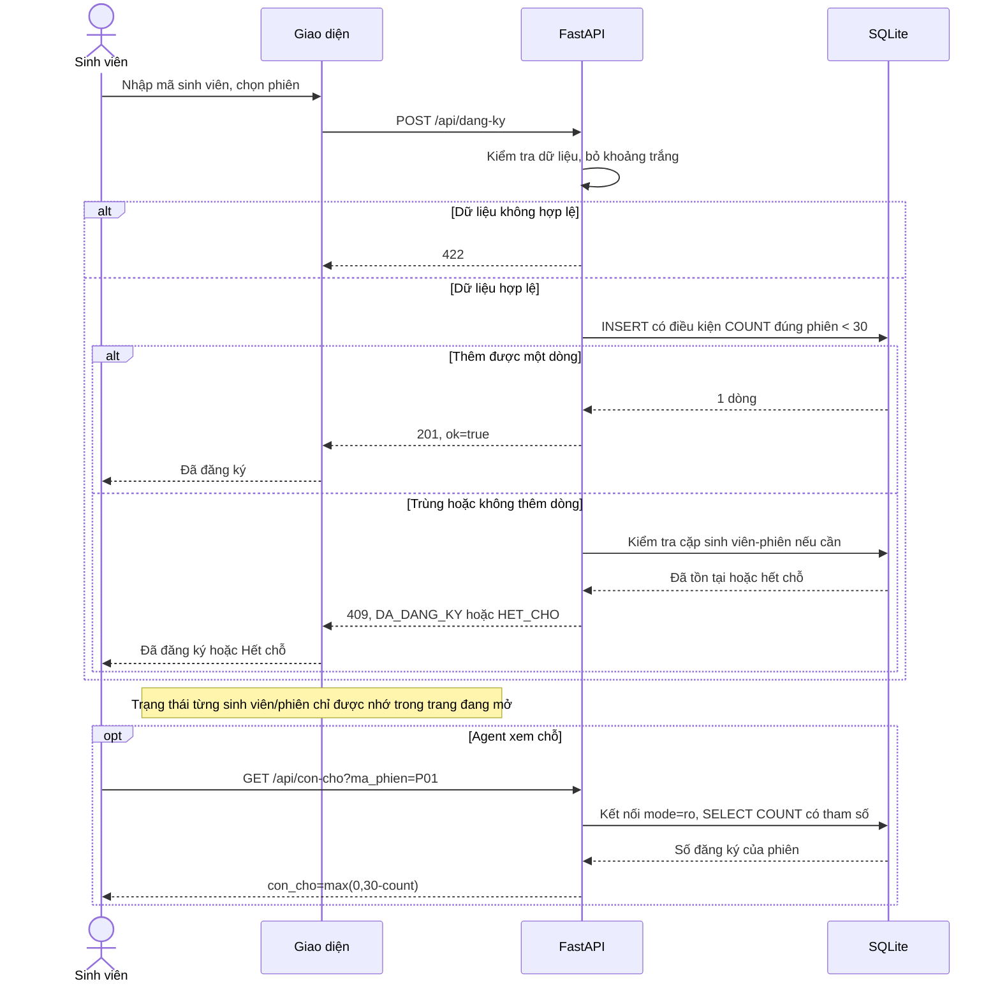

# Sơ đồ xử lý đăng ký và xem chỗ

UNIQUE(ma_sv,ma_phien) chặn trùng tại CSDL. COUNT nằm cùng câu INSERT để tránh nhận vượt 30 khi đồng thời. Đăng ký trùng được ưu tiên báo trước hết chỗ. GET chỉ là snapshot, không giữ chỗ, tạo bảng hay ghi dữ liệu. Lỗi SQLite trả LOI_CSDL, không lộ chi tiết.
