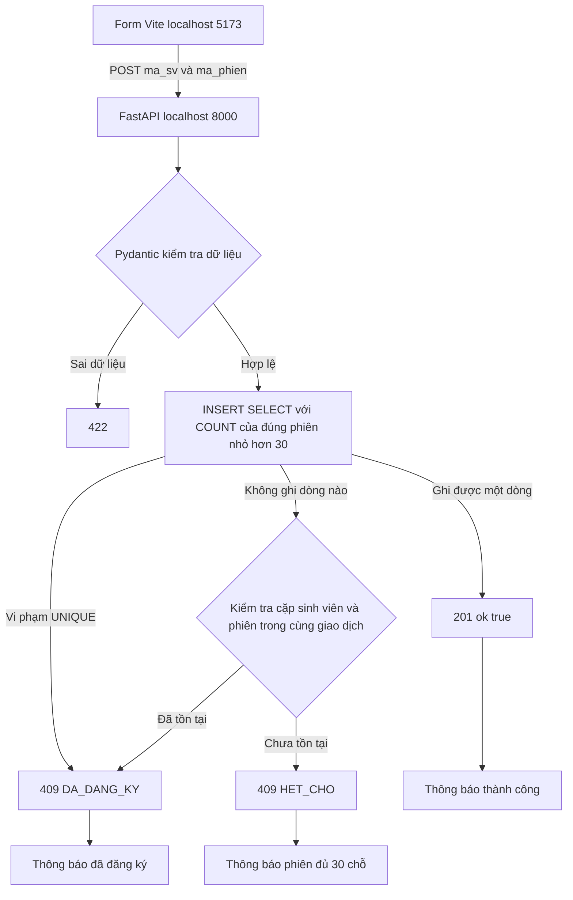

# Sơ đồ cổng đăng ký sau bài 4

SQLite giữ bảng dang_ky với UNIQUE(ma_sv, ma_phien). Mỗi yêu cầu có một kết nối riêng. Không đếm chỗ ở frontend. Khi INSERT không thêm dòng vì hết chỗ, cần kiểm tra lại cặp đăng ký để vẫn ưu tiên thông báo DA_DANG_KY.
